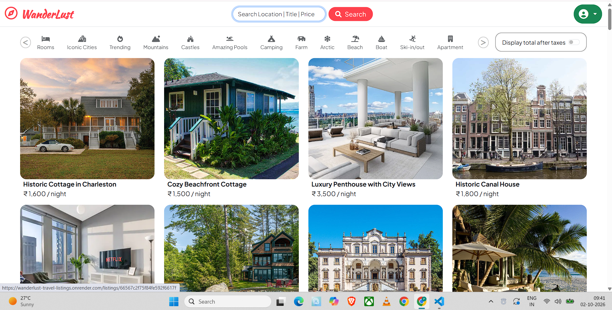
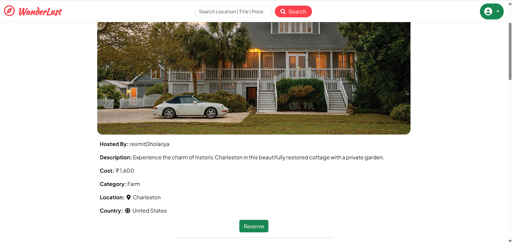
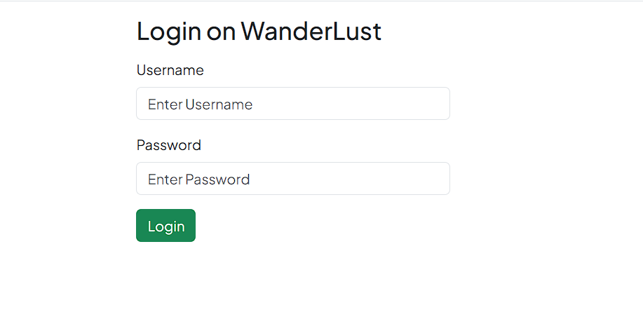
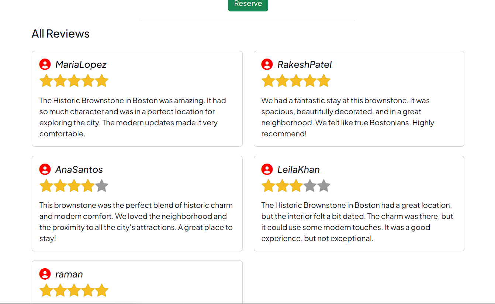

# StayFinder -- Travel & Stay Listing Platform

StayFinder is a full-stack travel and accommodation listing platform
inspired by Airbnb. Users can explore listings, view details, create
listings, upload images, add reviews, and manage their listings through
an authenticated web application.

## 🚀 Live Demo

**Live Website:**\
https://wanderlust-travel-listings.onrender.com/listings

**GitHub Repository:**\
https://github.com/PratikKothare123

## ✨ Features

-   Browse available travel and accommodation listings
-   View detailed information for each listing
-   User registration and login
-   Session-based authentication
-   Authorization for listing owners
-   Create, edit, and delete listings
-   Upload listing images
-   Image storage using Cloudinary
-   Add and delete reviews
-   Review validation
-   Flash messages for user feedback
-   Centralized error handling
-   Location-based listing support
-   Interactive maps using Leaflet and OpenStreetMap
-   Responsive interface using Bootstrap

## 🛠️ Tech Stack

### Frontend

-   HTML
-   CSS
-   JavaScript
-   EJS
-   Bootstrap
-   Leaflet

### Backend

-   Node.js
-   Express.js
-   MongoDB
-   Mongoose

### Authentication & Validation

-   Passport.js
-   Express Session
-   Joi

### Other Tools & Services

-   Cloudinary
-   OpenStreetMap
-   Nominatim
-   Git
-   GitHub
-   REST APIs

## 🏗️ Project Architecture

The application follows the **MVC (Model--View--Controller)**
architecture.

``` text
User
  ↓
EJS / Bootstrap / JavaScript
  ↓
Express Routes
  ↓
Controllers
  ↓
Mongoose Models
  ↓
MongoDB Atlas
```

For image uploads:

``` text
User Upload
    ↓
Multer
    ↓
Cloudinary
    ↓
Image URL + Public ID
    ↓
MongoDB
```

For location and maps:

``` text
Location Input
    ↓
Nominatim Geocoding
    ↓
Latitude / Longitude
    ↓
GeoJSON Point
    ↓
MongoDB
    ↓
Leaflet + OpenStreetMap
```

## 🔐 Authentication & Authorization

StayFinder uses session-based authentication with Passport.js.

-   Users can register and log in.
-   Protected routes require authentication.
-   Listing owners can edit or delete their own listings.
-   Review actions are protected for authenticated users.
-   Authorization is handled on the backend to prevent unauthorized
    operations.

## ☁️ Image Upload

Listing images are uploaded using:

**Multer → Cloudinary → MongoDB**

The application uses Cloudinary for image hosting instead of storing
image files directly on the application server.

## 🗺️ Location & Maps

The project uses:

-   **Nominatim** for geocoding
-   **OpenStreetMap** for map data
-   **Leaflet** for displaying interactive maps
-   **GeoJSON** for storing location coordinates

A listing's location is converted into coordinates and displayed on its
details page.

## 📸 Screenshots

Screenshots are available in the `screenshots/` folder.

### Home Page



The home page displays available travel and accommodation listings with
their images, titles, locations, and prices.

### Listing Details



The listing details page shows information about a selected property,
including its image, description, price, location, and available
actions.

### Login



The login page allows registered users to securely access their account.

### Reviews



The reviews section allows users to view and submit reviews for
listings.

## 📂 Project Structure

``` text
StayFinder/
│
├── controllers/
├── init/
├── middleware/
├── models/
├── public/
├── routes/
├── utils/
├── views/
├── screenshots/
│   ├── home.png
│   ├── listing-details.png
│   ├── login.png
│   └── reviews.png
│
├── cloudConfig.js
├── app.js
├── schema.js
├── package.json
└── README.md
```

## ⚙️ Installation & Setup

### 1. Clone the repository

``` bash
git clone https://github.com/PratikKothare123/stayfinder-mern.git
cd stayfinder-mern
```

### 2. Install dependencies

``` bash
npm install
```

### 3. Configure environment variables

Create a `.env` file and add the required MongoDB, Cloudinary, and
session configuration.

Example:

``` env
ATLASDB_URL=your_mongodb_connection_string
CLOUDINARY_CLOUD_NAME=your_cloudinary_cloud_name
CLOUDINARY_API_KEY=your_cloudinary_api_key
CLOUDINARY_API_SECRET=your_cloudinary_api_secret
SECRET=your_session_secret
```

Do not commit your `.env` file to GitHub.

### 4. Start the application

``` bash
node app.js
```

For development, if Nodemon is configured:

``` bash
nodemon app.js
```

The application will run locally on the configured port.

## 🔮 Future Improvements

-   GenAI-powered travel assistant
-   AI-based recommendation of places and activities
-   Search and filtering improvements
-   Better location-based recommendations
-   Email notifications
-   Password reset and account verification
-   Improved UI and mobile experience

## 👨‍💻 Author

**Pratik Kothare**

-   GitHub: https://github.com/PratikKothare123
-   LinkedIn: https://www.linkedin.com/in/pratik-kothare-99211628b/

## 📌 Project Status

**Active / Deployed**

The main StayFinder listing platform is deployed and available online.
GenAI-based travel assistance and recommendation features are currently
planned/in development.
